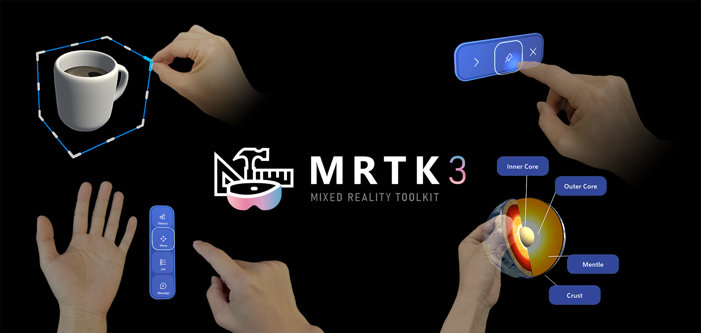

# Mixed Reality Toolkit for Unity

## BPF 项目说明

本仓库同时包含上游 MRTK 内容和本项目的 BPF 业务内容。

当前默认单人业务流为 `01StartUp -> 03SingleplayerScene`。Build Settings
同时启用了 `04SingleplayerScene`：

- `Assets/A_MRNet/Sence/01StartUp.unity`
- `Assets/A_MRNet/Sence/03SingleplayerScene.unity`
- `Assets/A_MRNet/Sence/04SingleplayerScene.unity`

`02SingleplayerScene.unity` 仍保留在工程中，但当前未加入 Build Settings，
也不是首页单人入口的默认目标。完整、可核对的当前基线见：

- [BPF 当前工程基线](./docs/current-project-baseline.md)
- [文档索引与状态](./docs/README.md)

除非任务明确提到 legacy networking、`_syc_resource`、`UDPLobby`、`MRTKsync` 或迁移排查，否则不要把以下内容当作当前业务主线入口：

- `Assets/APP/OldMRTK/*`
- `Assets/APP/ScenesNGOsync/*`
- `Assets/APP/Modules/LegacyMrtkSync/*`

`Assets/APP/MRTKSamples/*` 存放上游 MRTK 示例以及当前 BPF 场景仍在复用的
示例依赖，不属于 BPF 自有业务资产。`Assets/APP/Modules/LegacyMrtkSync/*`
是 `04SingleplayerScene` 仍有实际引用的遗留联机模块。
`Assets/APP/OldMRTK/*` 和 `Assets/APP/ScenesNGOsync/*` 继续作为历史/遗留区。

`Assets/APP/BPF/*` 是当前 BPF 兼容资产区，与上述遗留目录相互隔离；当前
散落字体统一位于 `Assets/APP/BPF/Compatibility/Fonts`。旧文档中的小写
`Assets/App/*` 与 `Assets/_syc_resource/*` 路径是历史迁移快照，当前工作树
中不存在这些根目录。

日常进行 BPF 协作开发时，先看这里：

- [BPF 前端协作开发流程](./docs/bpf-frontend-collaboration-guide.md)
- [BPF AI 协作开发流程](./docs/bpf-ai-collaboration-workflow.md)
- [BPF 项目模拟开发流程](./docs/mock-ai-development-flow.md)

如果你想直接看一轮“提需求 -> AI 改仓库 -> Unity/PICO 验证 -> 再迭代”的完整例子，
优先读这份模拟流程文档：

- [BPF 项目模拟开发流程](./docs/mock-ai-development-flow.md)

如果当前任务只涉及 BPF 业务配置，优先关注这些目录：

- `Assets/A_MRNet`
- `Assets/APP/BPF/Compatibility/Fonts`
- `Assets/Resources/BusinessPrefabs`
- `Assets/Resources/TopicPrefabs`
- `docs/`

## BPF PICO 4 业务发布说明

当前 PICO 构建使用 Build Settings 中启用的三张场景：

- `Assets/A_MRNet/Sence/01StartUp.unity`
- `Assets/A_MRNet/Sence/03SingleplayerScene.unity`
- `Assets/A_MRNet/Sence/04SingleplayerScene.unity`

当前 PICO 业务构建约束：

- Unity 版本固定为 `2021.3.29f1c1`
- Android 构建使用 `IL2CPP + ARM64`
- Android XR Plug-in Management 当前使用 `ARCore Loader + PXR Loader`
- Standalone / WSA 使用 OpenXR Loader；不能据此把 Android 描述为纯 OpenXR
- Build Settings 已启用上述三张场景
- 业务资源在 Android / PICO 上统一经由运行时资源服务访问
- `TMP_InputField` 在 Android / PICO 上统一走系统键盘桥接
- Quest 专用 `oculus.software.overlay_keyboard` manifest patch 已关闭

PICO 适配后的执行说明见：

- [docs/pico-readiness-audit.md](./docs/pico-readiness-audit.md)
- [docs/framework-pico-mainline-notes.md](./docs/framework-pico-mainline-notes.md)

上游 MRTK README 的英文说明已移至
[docs/mrtk-upstream-readme-archive.md](./docs/mrtk-upstream-readme-archive.md)
归档。

如果需要查阅原始框架介绍、包列表、支持设备、UX 组件、贡献与治理说明，
请直接阅读该归档文档。

## Repository Actions

The checked-in workflows are GitHub Actions workflows and use a self-hosted
Windows runner labeled `windows-host`. A local Gitea-compatible runner may also
execute them, but that external runner registration is not defined by this
repository.

The code validation workflow checks only the files changed by each push or pull request, which keeps the gate useful on this repository without failing on unrelated legacy issues elsewhere in the tree.

Changes to `.github/workflows/gh-pages.yml` also trigger the docs validation workflow so workflow edits can be verified immediately.

The documentation workflow validates the Jekyll build, but it does not deploy to GitHub Pages. Any public site deployment should be handled by separate infrastructure outside this repository.

Runner registration, installation path and live process state are external to
this repository. Verify the configured self-hosted runner before relying on a
queued workflow.

