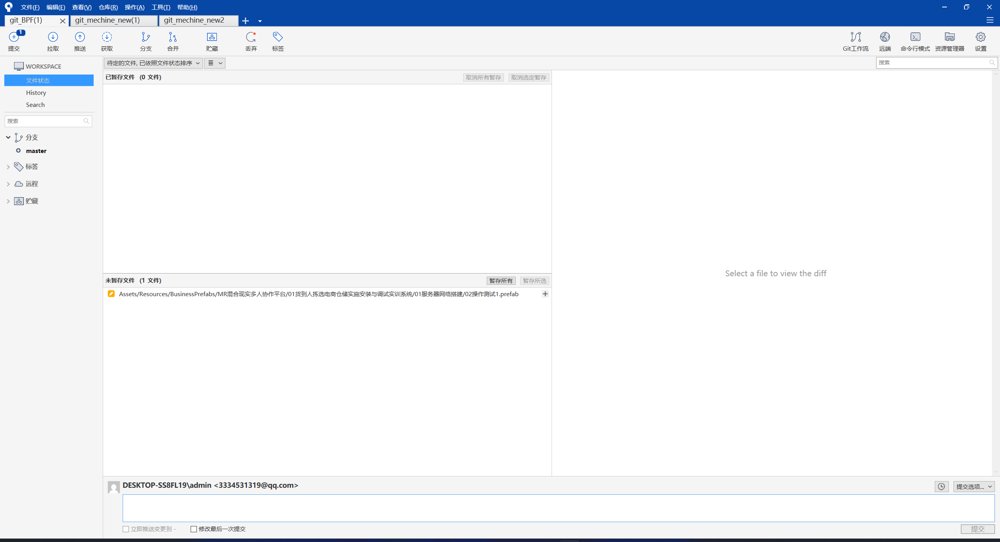
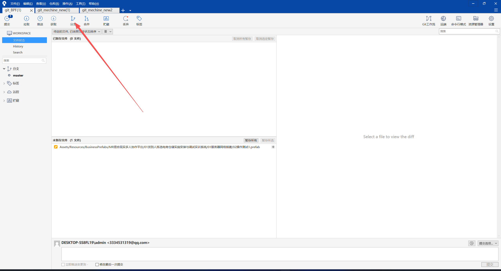
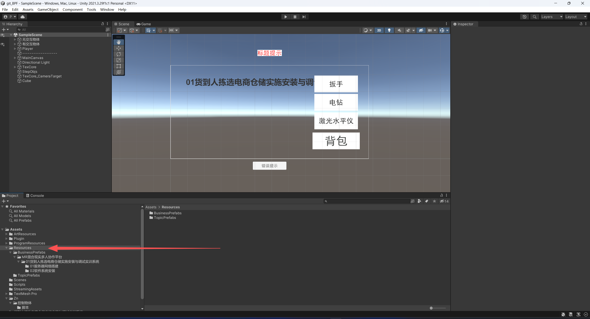
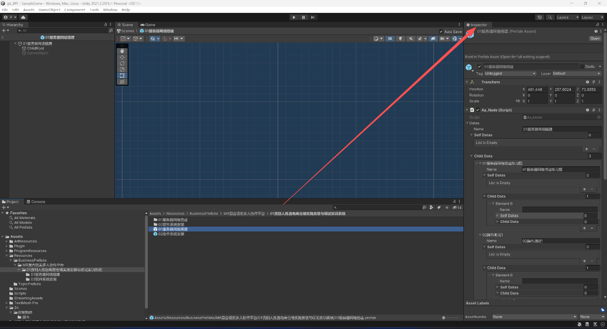
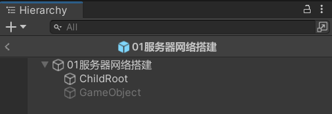
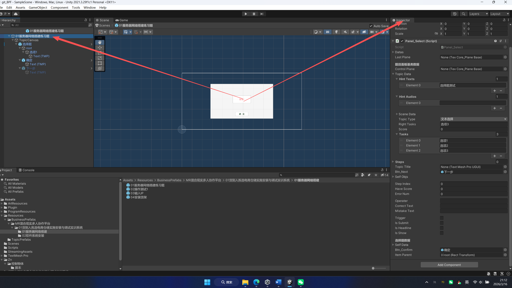
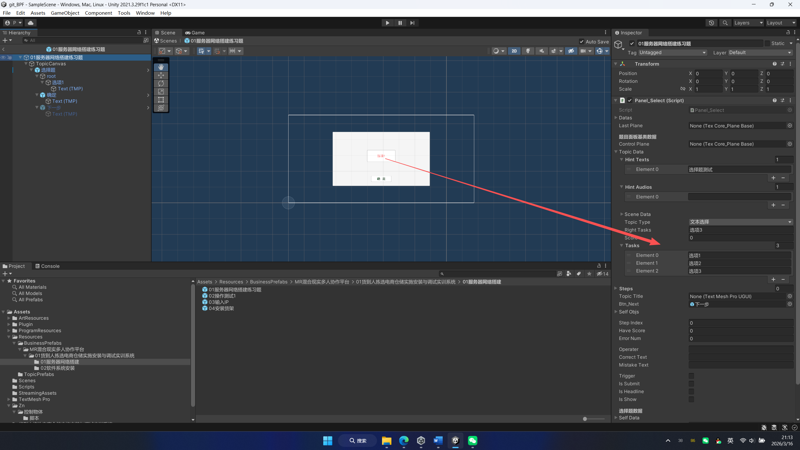
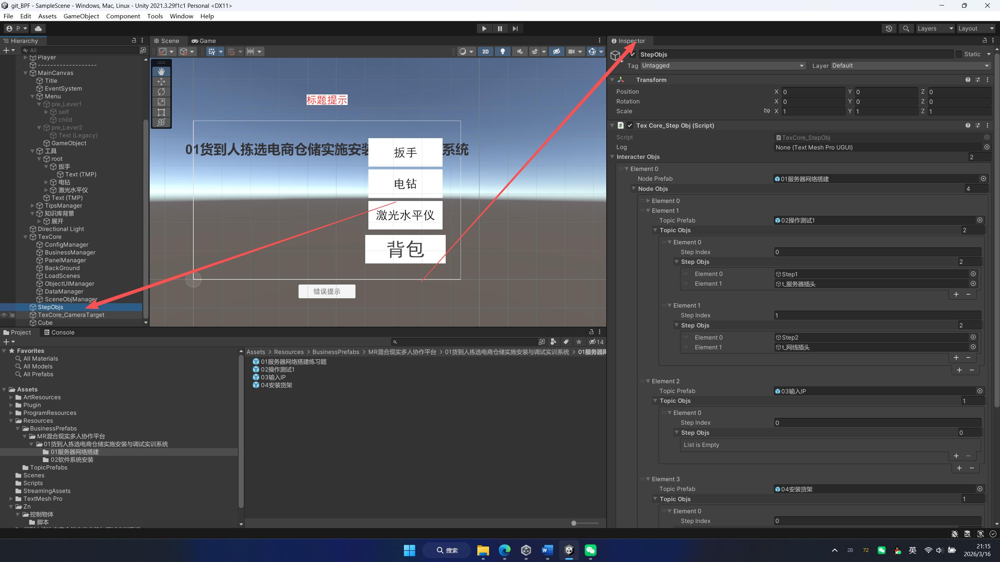
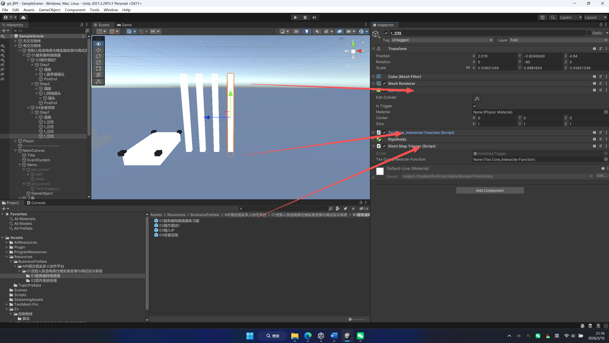

# BPF 前端协作开发流程

这份文档面向协作者，目标只有一个：按照固定流程完成 BPF 项目的界面、题目和场景交互配置，并且尽量不配错。

它不解释整个项目的运行原理，也不要求协作者理解全部脚本。只要按下面的约束做，前端侧开发就能落到正确位置。

## 1. 适用范围

这里的“前端开发”指的是 Unity 工程里的以下工作：

- 大关卡与子题目的流程配置
- 选择题等 UI 面板配置
- 场景中的 3D 交互步骤配置
- 完成后按规范提交 Git

不在本文档范围内的内容：

- 后端接口开发
- 全项目运行机制排查
- MRTK 示例场景维护
- 底层框架脚本改造

## 2. 开始前必须确认

### 开发环境

- Unity 版本：`2021.3.29f1c1`
- 仓库地址：`http://192.168.11.14:3000/admin/git_BPF.git`
- 设备：`PICO4U`
- Git 工具：`SourceTree` 或命令行均可

如果没有额外说明，业务配置通常从这个场景进入：

- `Assets/A_MRNet/Sence/03SingleplayerScene.unity`
- `Assets/A_MRNet/Sence/04SingleplayerScene.unity`（Build Settings 中额外启用）

### Git 基本动作

每次开始前先做这三件事：

1. 切到最新主干并拉取更新。
2. 基于主干新建一个分支，再开始本次任务。
3. 再打开 Unity。

推荐分支名直接写任务，例如：

- `feature/bpf-node-server-network`
- `feature/bpf-ui-software-install`

## 3. 先记住三个硬规则

### 规则 1：不要手改 `Config.xml`

当前工程会根据 `Assets/Resources/BusinessPrefabs` 下的预制体数据生成配置文件，运行时读取的是生成结果，不是你手写的 XML。

结论：**配置改预制体，不改 `Assets/StreamingAssets/Config.xml`。**

### 规则 2：名称必须对齐

这套框架按名字加载节点和题目。下面几处名字必须一致：

- 预制体文件名
- 节点或题目在数据里的引用名
- 父节点 `childData` 中填写的子项名称

只要名字有一个字不一样，运行时就可能找不到对应预制体。

### 规则 3：改完必须保存 Prefab 和 Scene

很多错误不是“没配对”，而是“配完没保存”。

- 在 Prefab Mode 中修改预制体后，立即保存。
- 在 Scene 中配置 3D 交互后，立即保存场景。

## 4. 项目里真正要改的地方

### 4.1 业务流程预制体目录

业务流程配置主要在这里：

`Assets/Resources/BusinessPrefabs`

当前项目里已经有现成结构，例如：

- `Assets/Resources/BusinessPrefabs/MR混合现实多人协作平台`
- `Assets/Resources/BusinessPrefabs/MR混合现实多人协作平台/01货到人拣选电商仓储实施安装与调试实训系统`

新增节点、题目时，继续沿用这个目录结构，不要另起一套路径。

### 4.2 题目模板目录

通用题目模板在这里：

`Assets/Resources/TopicPrefabs`

当前可见模板包括：

- `选择题.prefab`
- `确定.prefab`
- `下一步.prefab`

新题目优先复制已有同类题目或模板，不要从空白物体重新搭一套。

### 4.3 主要脚本角色

协作者只需要知道下面几个脚本的职责：

- `Aa_Node`：大关卡节点
- `Panel_Select`：选择题面板
- `TexCore_StepObj`：场景里的步骤树
- `TexCore_InteracterFunction`：交互物体在不同状态下的表现

不需要主动修改这些脚本，重点是按它们要求去配数据。

## 5. 标准开发流程

### 步骤 1：先判断这次任务属于哪一类

通常只会落在三类里：

1. 新增或修改大关卡节点
2. 新增或修改题目 UI
3. 新增或修改场景中的 3D 交互步骤

不要一上来同时改三类。先确定本次任务属于哪一类，再动手。

### 步骤 2：只在正确位置配置

- 流程节点、题目数据：改 `Prefab`
- 3D 交互对象和步骤树：改 `Scene`

如果位置改错，配置通常不会生效。

### 步骤 3：完成后做一次固定自检

自检清单见第 9 节。没过自检，不要提交。

## 6. 大关卡节点配置

这一部分对应 `Aa_Node`。

### 6.1 新建位置

在 `Assets/Resources/BusinessPrefabs` 的业务目录下：

1. 新建节点文件夹。
2. 新建同名节点预制体。
3. 双击进入 Prefab Mode。

建议直接复制一个已存在的同类节点，再改名和内容，比从空白预制体开始更稳。

### 6.2 必配内容

节点预制体根节点需要挂 `Aa_Node`。

重点配置两块数据：

1. `selfDatas[0].sceneData`
2. `childData`

### 6.3 `sceneData` 怎么填

`sceneData.sceneName` 用于进入该节点时是否切场景。

- 需要切场景：填写目标场景名
- 不需要切场景：留空

这里不要凭记忆瞎填。先在工程里确认目标场景真实名称，再复制进去。

如果是新增场景，不仅要名字对，还要确认它已经接入当前项目的加载流程；最稳妥的做法是先复用项目里已经能正常切换的场景名和现有接入方式。

### 6.4 `childData` 怎么填

`childData` 不是拖场景物体，也不是拖预制体引用，而是**按顺序填写子题目名称**。

例如：

- `01服务器网络搭建练习题`
- `02操作测试`
- `03操作测试`

运行时会按这些名字去同级目录加载对应题目预制体。

### 6.5 最容易犯的错

- 节点预制体名和目录名不一致
- `childData` 里写的名字和子题目预制体文件名不一致
- 以为把物体拖进列表就行，实际上这里走的是名称匹配
- 改完没保存 Prefab

## 7. 选择题 UI 配置

这一部分对应 `Panel_Select`。

### 7.1 最稳的创建方式

不要从零开始搭。

推荐顺序：

1. 复制一个现有选择题预制体；或者
2. 从 `Assets/Resources/TopicPrefabs/选择题.prefab` 出发；然后
3. 把新题目预制体放到对应节点目录下。

### 7.2 必须理解的数据顺序

`Panel_Select` 读取数据时，顺序是固定的：

1. `selfDatas[0]` 是题目基础数据
2. `selfDatas[1]` 是选择规则数据

结论：**题目数据顺序不能乱。**

如果顺序错了，题型、答案和分值都会读错。

### 7.3 必配字段

#### 题目基础数据

第一组数据里重点看这些字段：

- `topicType`
- `tasks`
- `rightTasks`
- `score`
- `hintTexts`

文本选择题时：

- `topicType` 选“文本选择”
- `tasks` 里按顺序填所有选项文本
- `rightTasks` 填正确答案名称
- `score` 填该题分数

多选题时，`rightTasks` 必须用半角下划线连接，例如：

`选项A_选项C`

注意：这里匹配的是**选项名字本身**，不是 A/B/C 编号。

#### 选择规则数据

第二组数据里重点看：

- `selecionCount`

按题型选择：

- 单选
- 多选
- 不定项选择

### 7.4 `Item Parent` 的硬要求

`Panel_Select` 运行时会拿 `Item Parent` 下的第一个子物体当模板，再自动复制后续选项。

所以在保存预制体时：

- `Item Parent` 必须已经拖好
- 其下只保留 **1 个** 选项模板子物体最稳

如果你把多个运行时生成出来的选项一并保存进预制体，之后再次进入题目时就容易出现重复选项。

### 7.5 `Btn Confirm` 的要求

`Btn Confirm` 必须绑定到当前题目的“确定”按钮。

如果没绑，脚本会尝试找名为“确定”的子物体；但不要依赖自动查找，直接拖引用更稳。

### 7.6 文本换行

选项文本需要换行时，用 `\n`。

脚本会在运行时把它转成真正换行。

### 7.7 最容易犯的错

- `rightTasks` 写成 “A” “B”，但实际选项名不是这个
- 多选答案用了中文顿号、逗号，而不是半角下划线
- `selfDatas` 顺序写反
- `Item Parent` 下面保留了多个模板项
- 只保存了场景，没保存题目预制体

## 8. 3D 交互与步骤配置

这一部分发生在场景里，不是在题目预制体里。

### 8.1 步骤树在哪里配

场景中的 `TexCore_StepObj` 负责维护步骤树，核心字段是：

- `interacterObjs`

它是三级结构：

1. `NodeObjs`
2. `TopicObjs`
3. `StepObjs`

每一级都要和真实流程一一对应。

### 8.2 三级结构怎么对

可以按下面理解：

- `NodeObjs`：一个大关卡节点
- `TopicObjs`：该节点下的一道题
- `StepObjs`：该题里的一个步骤

`StepObjs.stepObjs` 里放的是当前步骤允许响应的 3D 物体。

### 8.3 `stepIndex` 怎么理解

`stepIndex` 不是随便写的备注号，而是脚本真正用来触发步骤状态的索引。

简单记法：

- 选择题、填空、对话、放置类题目：通常只会触发 `stepIndex = 0`
- 多步骤操作题：按实际操作顺序递增配置

如果步骤顺序对不上，常见现象就是：

- 该亮的物体不亮
- 该点的物体点不了
- 上一步或下一步的物体提前激活

### 8.4 交互物体最少要具备什么

要放进步骤树的交互物体，至少检查这些组件：

- 碰撞体，例如 `BoxCollider`
- 交互状态脚本，例如 `TexCore_InteracterFunction`

如果 `TexCore_InteracterFunction` 里启用了以下能力，还要额外满足对应条件：

- `isSetState`：物体上还要有 `TexCore_SelectBase` 体系的交互脚本
- `isPlayAnimation`：物体上要有 `Animator`，并且动画名准确
- `isTarget`：必须拖入目标点 `Transform`

否则状态切换时会表现异常，甚至直接报错。

### 8.5 四种状态怎么配

`TexCore_InteracterFunction` 里常用四组状态：

- 未完成
- 进行中
- 触发
- 已完成

常见做法：

- 进行中：打开碰撞、高亮或显示
- 触发：播放动作、移动到目标点、执行事件
- 已完成：关闭碰撞，保留完成态

不要一次把所有状态都勾满。只开当前题目真正需要的行为。

### 8.6 最容易犯的错

- 物体已经放进 `stepObjs`，但没挂交互状态脚本
- 配了 `isSetState`，物体上却没有可用的选择脚本
- 动画名拼错
- `stepIndex` 顺序和题目逻辑不一致
- 场景改完没保存

## 9. 提交前自检清单

提交前逐项确认：

- 节点名、题目名、`childData` 引用名完全一致
- 所有改动过的 Prefab 已保存
- 所有改动过的 Scene 已保存
- 选择题的 `selfDatas` 顺序正确
- `Item Parent` 下只保留一个选项模板
- 多选题 `rightTasks` 用半角下划线连接
- 3D 交互物体的 `stepIndex` 与题目步骤一致
- 新增或移动文件后，对应 `.meta` 文件也已纳入版本控制

## 10. Git 提交规则

### 10.1 应该提交什么

本类任务通常应该提交这些文件：

- `.prefab`
- `.unity`
- 对应 `.meta`
- 文档文件

### 10.2 不应该随手提交什么

通常不要提交这些无关文件：

- `Library/`
- `Logs/`
- `UserSettings/`

另外，`Packages/packages-lock.json` 如果不是你本次任务主动改动的结果，提交前要确认原因。

### 10.3 提交说明怎么写

提交信息直接写“做了什么”，不要只写“更新”。

可参考：

- `docs: 补充 BPF 前端协作开发流程`
- `feat: 完成 01服务器网络搭建 选择题配置`
- `fix: 修正 02操作测试 步骤树映射`

### 10.4 提交流程

1. 查看改动文件，只保留和本次任务直接相关的内容。
2. 暂存相关文件。
3. 提交，并写清楚备注。
4. 推送到远端分支。

## 11. 推荐工作习惯

为了减少返工，建议固定按这个节奏工作：

1. 先复制最接近的现有节点或题目。
2. 只改名字、数据和必要引用。
3. 改完立即保存。
4. 先做一次自检，再看版本差异。
5. 确认无误后再提交。

## 12. 一句话原则

**这套项目优先靠“现有模板 + 正确命名 + 正确保存”完成配置，不要把简单配置任务做成脚本开发任务。**
